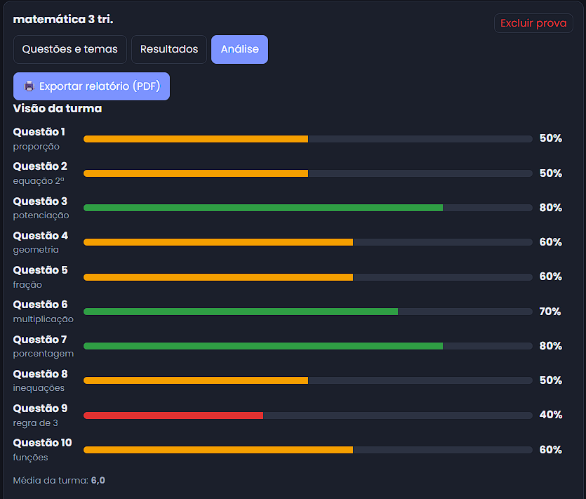
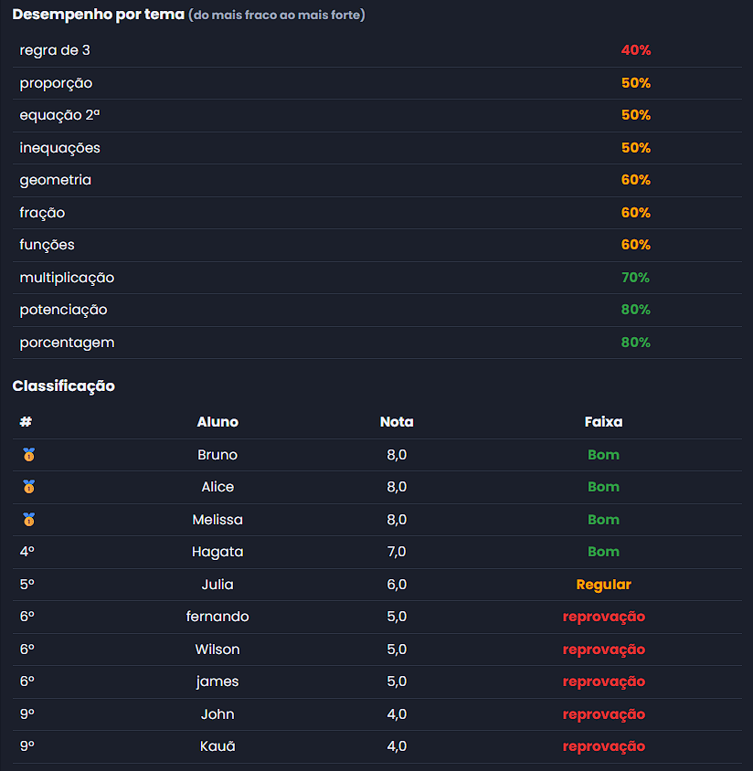

# ✓ Acertô

**Painel do Professor: descubra em qual assunto sua turma está errando.**

🔗 **Acesse o site:** (https://starrabbit74.github.io/Acerto--painel-para-professores/)

 

 

## O problema

Depois de corrigir uma prova, o professor vê as notas, mas não sabe **em quais assuntos a turma teve mais dificuldade**. Sem esse diagnóstico, é difícil decidir o que revisar em sala.

## A solução

O **Acertô** transforma os resultados de uma prova em um diagnóstico claro, mostrando onde a turma acertou, onde errou e quais alunos precisam de reforço.

## Funcionalidades

- **Turmas e alunos:** cadastro simples de turmas e alunos.
- **Provas de 10 questões:** cada prova tem uma matéria e, opcionalmente, um subtópico por questão.
- **Registro de resultados:** o professor marca as questões que cada aluno acertou.
- **Visão da turma:** porcentagem de acertos por questão e por tema, destacando os pontos fracos.
- **Visão individual:** acertos e nota de cada aluno.
- **Classificação:** ranking dos alunos, com a faixa "Recuperação" para notas abaixo de 6.
- **Evolução entre provas:** comparação das provas da mesma matéria, com setas de melhora ▲ e queda ▼.
- **Relatório em PDF:** exporta a análise pronta para imprimir ou compartilhar.

## Como usar

1° Crie uma turma e cadastre os alunos.
2° Crie uma prova informando o nome e a matéria.
3° Marque as questões que cada aluno acertou na aba **Resultados**.
4° Abra a aba **Análise** para ver o diagnóstico da turma e o ranking.

## Tecnologias

- HTML, CSS e JavaScript puro (sem frameworks)
- Dados salvos no navegador com `localStorage`
- Hospedado com GitHub Pages

## Próximos passos

- Login para professores
- Banco de dados para guardar os dados na nuvem
- Exportar os resultados em planilha (CSV)
- Provas com número variável de questões

## Equipe

- John gabriell
- Hagata Marize
- Kauã Fernando
